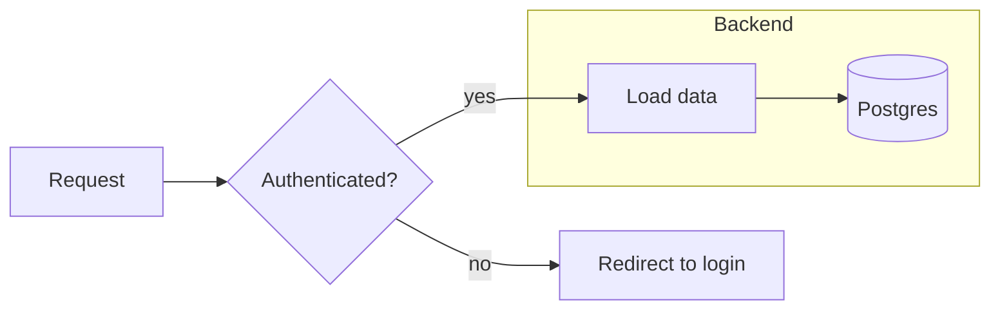
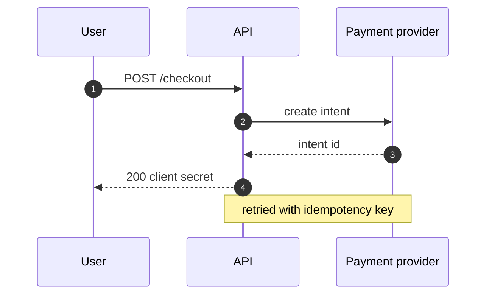
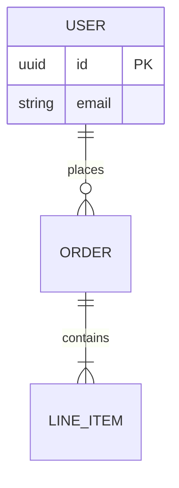
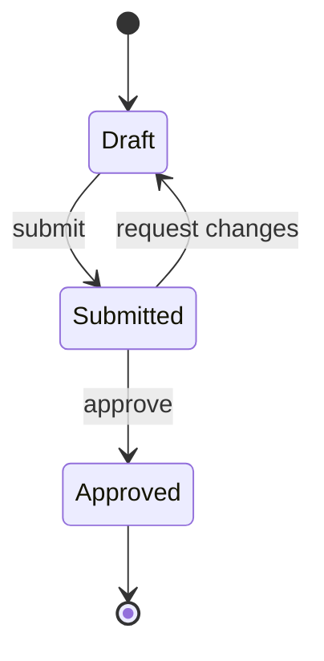

# Mermaid Diagrams

## When to Use This Skill
- Explaining a flow in a README, PR, ADR, or docs page
- Diagrams that should be reviewed and diffed like code
- Fixing Mermaid syntax errors or tangled layouts

## Pick the right diagram
| Need | Type |
|------|------|
| Process, decision logic | `flowchart` |
| Request/response between services | `sequenceDiagram` |
| Database tables and relations | `erDiagram` |
| Lifecycle of an entity | `stateDiagram-v2` |
| Plan over time | `gantt` |

## Flowchart

## Sequence

## ER

## State

## Layout and readability
- Choose direction for the reader: `LR` for pipelines, `TD` for hierarchies.
- Keep to ~15 nodes; split larger diagrams by concern.
- Short labels on nodes; put detail in surrounding text.
- Quote labels with special characters: `A["Price (USD)"]`.
- Use `subgraph` to group by boundary (service, network zone).
- Style sparingly: `classDef warn fill:#fee,stroke:#c00;` then `class D warn;`.

## Rendering
- GitHub, GitLab, Docusaurus, Starlight (plugin), VitePress (plugin), and Obsidian render fenced `mermaid` blocks.
- Export SVG/PNG with `@mermaid-js/mermaid-cli` (`mmdc -i in.mmd -o out.svg`) for slides.
- Test edits in the Mermaid Live Editor.

## Rules
- Diagram the thing readers ask about, not every component.
- Update diagrams in the same PR as the architecture change.
- Prefer one clear diagram over three overlapping ones.
